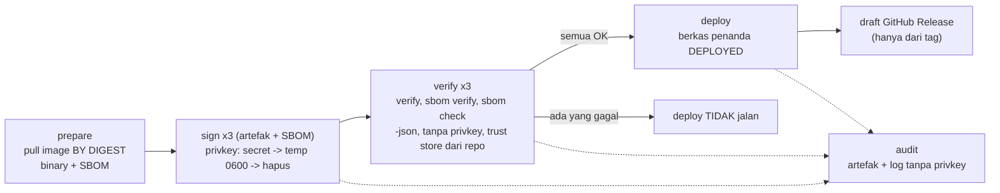

# ci/: pipeline contoh pemakai image

[`release-pipeline.yml`](../.github/workflows/release-pipeline.yml) memakai image `sister-sign` sebagai kakas (tanpa build dari source) untuk menandatangani dan memverifikasi artefak rilis, lalu memblokir deploy kalau verify gagal.



| Tahap | Job | Skrip | Aturan |
|---|---|---|---|
| Persiapan | `prepare` | [`resolve-image.sh`](resolve-image.sh), [`extract-binary.sh`](extract-binary.sh), [`make-sbom.sh`](make-sbom.sh) | image wajib `<repo>@sha256:<digest>`; tag ditolak; digest hasil pull dicocokkan; SBOM CycloneDX memuat SHA-256 binary |
| Sign | `sign` (matrix 3 profil) | [`sign-artifact.sh`](sign-artifact.sh) | privkey hanya dari env `SIGNING_KEY` (secret), ditulis ke temp file `0600` di `$RUNNER_TEMP`, di-mount `:ro`, ditimpa nol lalu dihapus; artefak (`sign`) dan SBOM (`sbom sign`) dalam satu sesi kunci; output dicek tidak memuat privkey |
| Verify | `verify` (matrix 3 profil) | [`verify-artifact.sh`](verify-artifact.sh), [`verify-sbom.sh`](verify-sbom.sh) | `verify -json`, `sbom verify -json`, `sbom check -json`; trust store = `ci/trust-store.json` dari checkout (bukan dari bundle/artefak); exit code asli yang menentukan |
| Deploy | `deploy` (`needs: verify`) | [`deploy-marker.sh`](deploy-marker.sh) | sha256 artefak harus sama dengan yang diverifikasi; tiap hasil verify harus exit 0 + `OK`; tulis `DEPLOYED` |
| Audit | `audit` (`if: always()`) | [`audit-no-privkey.sh`](audit-no-privkey.sh) | semua artefak run + log job yang selesai: tanpa blok PEM privkey / berkas kunci |
| Rilis | `release` (tag saja) | [`release-notes.sh`](release-notes.sh) | draft GitHub Release dari isi `deploy/` (lihat [`docs/release.md`](../docs/release.md)) |

Semua container dijalankan lewat `tool_run` di [`lib.sh`](lib.sh): `--network none`, `--user $(id -u):$(id -g)`, `--read-only`, `--cap-drop ALL`, `--security-opt no-new-privileges`, tanpa `-t`, stdin `/dev/null`. Input selalu `:ro`; hanya direktori output yang bisa ditulis. Tidak ada `continue-on-error` dan tidak ada `|| true` di jalur sign → verify → deploy.

Artefak rilis contoh adalah binary `sister-sign` itu sendiri (`sister-sign-linux-amd64`), diambil dari image yang sudah di-pull by digest, dengan package `sister-sign` dan versi dari `sister-sign -version`.

## Pemicu

| Pemicu | Image | Catatan |
|---|---|---|
| push tag `v*` | digest yang baru di-push oleh `build-image.yml` (job `release-pipeline`) | setelah pull anonim lulus; diakhiri draft GitHub Release |
| *Actions → release-pipeline → Run workflow* | input `image`, atau baris pertama [`image-ref.txt`](image-ref.txt) | centang `tamper` untuk uji negatif (verify harus gagal, deploy tidak jalan) |

## Secret

Kunci **demo** (khusus tugas ini, bukan kunci produksi). Pubkey-nya di [`keys/`](keys/) dan sudah ada di [`trust-store.json`](trust-store.json) untuk package `sister-sign`. Privkey TIDAK ada di repo.

| Secret | Isi | keyid |
|---|---|---|
| `DEMO_KEY_ED25519` | PEM PKCS#8 `demo-ed25519.key.pem` | `0d214f471467482b474a254f8e68cb1ca16cf8ace8fa509a37dacdb4b5a81880` |
| `DEMO_KEY_ECDSA_P256` | PEM PKCS#8 `demo-ecdsa-p256.key.pem` | `8921af99a9147fadfc6e36cf9f3b12a83e43dd2be516ab5e2d24fd8fedd602a4` |
| `DEMO_KEY_RSA_PSS` | PEM PKCS#8 `demo-rsa-pss.key.pem` | `80fca169af3a25d1a35c6c28b9b9254cf9ddce7a08508511a0661d2a4d355b85` |

Set lewat *Settings → Secrets and variables → Actions → New repository secret* (tempel isi PEM utuh), atau:

```sh
gh secret set DEMO_KEY_ED25519    < demo-ed25519.key.pem
gh secret set DEMO_KEY_ECDSA_P256 < demo-ecdsa-p256.key.pem
gh secret set DEMO_KEY_RSA_PSS    < demo-rsa-pss.key.pem
```

Mengganti kunci demo: buat pasangan baru, `trust add` pubkey-nya ke `ci/trust-store.json` (dan `trust remove` keyid lama), salin pubkey ke `ci/keys/`, lalu perbarui secret. Contoh dengan image:

```sh
docker run --rm --network none -v "$PWD/secret:/out" <image@digest> keygen -algorithm ed25519 -out /out/demo-ed25519
docker run --rm --network none -v "$PWD/ci:/ci" -v "$PWD/secret:/k:ro" <image@digest> \
  trust add -store /ci/trust-store.json -key /k/demo-ed25519.pub.pem -package sister-sign
```

## Jalan di luar GitHub Actions

Urutan dan skrip yang sama dengan workflow:

```sh
# image harus by digest; untuk image lokal, push dulu ke registry lokal
docker run -d -p 5000:5000 --name registry registry:2
docker build -t sister-sign:dev .
docker tag sister-sign:dev localhost:5000/sister-sign:dev && docker push localhost:5000/sister-sign:dev
ref="$(docker image inspect --format '{{index .RepoDigests 0}}' localhost:5000/sister-sign:dev)"

# jalur sah (dir-privkey berisi demo-ed25519.key.pem, demo-ecdsa-p256.key.pem, demo-rsa-pss.key.pem)
bash ci/pipeline-local.sh "$ref" /path/ke/privkey-demo out/run1          # -> out/run1/deploy/DEPLOYED
# uji negatif
bash ci/pipeline-local.sh "$ref" /path/ke/privkey-demo out/run2 --tamper # -> exit 1, tanpa DEPLOYED
```

Uji otomatis tanpa secret (kunci + trust store sementara), juga dijalankan di job PR `build-image`:

```sh
bash ci/test-pipeline.sh sister-sign:dev localhost:5000
```

Hasil lokal (15 Nov 2026, Docker Desktop 28.5.1): 26/26 cek lulus.

| Skenario | Hasil |
|---|---|
| jalur sah | exit 0; verify, sbom verify, sbom check x3 exit 0 `OK`; `deploy/DEPLOYED` dan SBOM ada di `deploy/` |
| artefak diubah 1 byte setelah sign | exit 1; verify x3 exit 1 `ARTIFACT_MISMATCH`; sbom verify x3 tetap `OK` (SBOM utuh) tetapi sbom check x3 exit 1 `ARTIFACT_MISMATCH`; `deploy/DEPLOYED` tidak ada |
| audit | output dan log kedua run tanpa privkey; temp file kunci sudah hilang |

Penolakan lain yang sudah dicoba: image by tag (`localhost:5000/sister-sign:test`) → exit 1 sebelum pull; `SIGNING_KEY` kosong → exit 1 sebelum container jalan; placeholder `image-ref.txt` → exit 1.

## Berkas

| Berkas | Isi |
|---|---|
| `trust-store.json` | trust store demo (`minisign-trust/v1`), 3 kunci untuk package `sister-sign` |
| `keys/*.pub.pem` | pubkey demo (SPKI PEM) |
| `image-ref.txt` | image by digest untuk run manual |
| `check-image.sh` | cek image (dipakai `build-image.yml`) |
| `lib.sh` | helper bersama (`tool_run`, `json_step`, `require_digest_ref`, `host_path`) |
| `release-check.sh` | pemeriksaan sebelum tag (privkey di seluruh histori git, versi, laporan); lihat `docs/release.md` |

Skrip juga jalan di Git Bash + Docker Desktop (Windows): path untuk `docker -v` dikonversi dengan `cygpath`.
