# Rilis v0.1.0 dan pengumpulan (T36)

Pemegang rilis: C (Cola1000). Deadline: **Senin 16 Nov 2026, 23.59 WIB**.

## Alur

```mermaid
flowchart LR
  A["semua PR merge ke main<br/>(T27, T28, T30, T31, T34 ...)"] --> B["laporan PDF final<br/>laporan/NIM1_NIM2_NIM3_Tugas3_IF4020.pdf"]
  B --> C["bash ci/release-check.sh v0.1.0"]
  C --> D["git tag v0.1.0 + push"]
  D --> E["build-image: push GHCR<br/>+ pull anonim by digest"]
  E --> F["release-pipeline: sign -> verify -> deploy<br/>-> draft GitHub Release"]
  F --> G["lampirkan PDF, isi digest,<br/>Publish release"]
  G --> H["cek dari akun non-kolaborator<br/>+ submit Google Form"]
```



## Checklist

### Sebelum tag

- [ ] Semua task wajib merge ke `main`, CI hijau (`build + test`, `ASAN + UBSAN`, `clang-format`, `build-image`).
- [ ] Tiga secret kunci demo diset: `DEMO_KEY_ED25519`, `DEMO_KEY_ECDSA_P256`, `DEMO_KEY_RSA_PSS` ([`ci/README.md`](../ci/README.md#secret)).
- [ ] *Settings → Actions → General → Workflow permissions*: **Read and write** (untuk push GHCR dan membuat draft release).
- [ ] Repo **publik** (*Settings → General → Danger Zone → Change visibility*).
- [ ] Laporan: semua `\isi{...}` terisi (nama/NIM, foto `laporan/images/foto-{1,2,3}.jpg`, pernyataan bertanda tangan `laporan/images/pernyataan.pdf`, Bab 4, interop/demo di Bab 5, tautan run). Build: `cd laporan && latexmk` → `laporan/build/main.pdf`, salin ke `laporan/NIM1_NIM2_NIM3_Tugas3_IF4020.pdf`.
- [ ] **Pernyataan** di halaman pernyataan sesuai kenyataan cara pengerjaan (keputusan dan tanggung jawab bertiga).
- [ ] `bash ci/release-check.sh v0.1.0` → `0 gagal` (memeriksa privkey di **seluruh histori git**, berkas kunci ter-track, kesamaan versi; peringatan untuk `\isi{}`, PDF, digest).

### Tag dan image

```sh
git switch main && git pull
bash ci/release-check.sh v0.1.0
git tag -a v0.1.0 -m "sister-sign 0.1.0"
git push origin v0.1.0
```

- [ ] Workflow `build-image` (tag): job `build + push to GHCR` hijau. Rilis pertama: bila `anonymous pull by digest` gagal, ubah visibility package ke **Public** lalu *Re-run failed jobs* ([`container-image.md`](container-image.md#rilis-ke-ghcr)).
- [ ] Job `release pipeline` hijau: sign ×3, verify ×3, deploy, audit; lalu **draft** release `v0.1.0` terbentuk.
- [ ] Salin digest dari job summary ke: tabel [README](../README.md#versi--tag--digest), [`docs/container-image.md`](container-image.md#versi--tag--digest), [`ci/image-ref.txt`](../ci/image-ref.txt), dan `\imagedigest` di `laporan/main.tex` (PR kecil setelah tag; tidak mengubah image).

### GitHub Release

Draft release dibuat otomatis berisi (dari job `deploy` yang sudah lolos verify):

| Berkas | Isi |
|---|---|
| `sister-sign-linux-amd64` | executable (binary dari image by digest) |
| `sister-sign-linux-amd64.{ed25519,ecdsa-p256-sha256,rsa-pss-sha256}.bundle.json` | bundle tanda tangan executable |
| `verify-*.json` | hasil `verify -json` di pipeline |
| `trust-store.json` | trust store demo |
| `DEPLOYED`, `SHA256SUMS`, `image-digest.txt` | penanda deploy, checksum, link image + digest |

- [ ] Lampirkan `NIM1_NIM2_NIM3_Tugas3_IF4020.pdf` (*Edit release → Attach binaries*).
- [ ] Catatan rilis sudah memuat tabel image + digest (dibuat [`ci/release-notes.sh`](../ci/release-notes.sh)); tambahkan tautan workflow run.
- [ ] **Publish release**.

### Setelah rilis

- [ ] Buka link Release dari akun **non-kolaborator** / jendela privat: PDF dan executable bisa diunduh.
- [ ] Dari mesin bersih (tanpa login GHCR): `docker logout ghcr.io; docker pull ghcr.io/filbertengyo/sisters-sign@sha256:<digest>`; digest di `docker image inspect` sama.
- [ ] Verifikasi executable yang diunduh dengan perintah di catatan rilis → `{"valid":true,"status":"OK",...}`.
- [ ] Submit link repo + Release ke Google Form; simpan tangkapan layar/email konfirmasi sebagai bukti submit.

## Bila waktu mepet

- Draft release gagal dibuat (mis. secret belum diset): buat release manual dari tag `v0.1.0`, lampirkan PDF + binary hasil `bash ci/extract-binary.sh ghcr.io/filbertengyo/sisters-sign@sha256:<digest> dist` + `image-digest.txt`. Catat di release bahwa bundle dibuat manual.
- Jangan menghapus/memindah tag yang sudah di-push; buat `v0.1.1` bila perlu perbaikan, lalu perbarui tabel digest.
